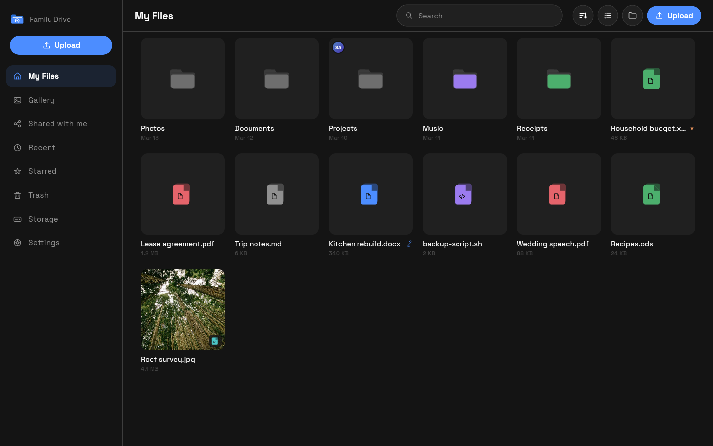
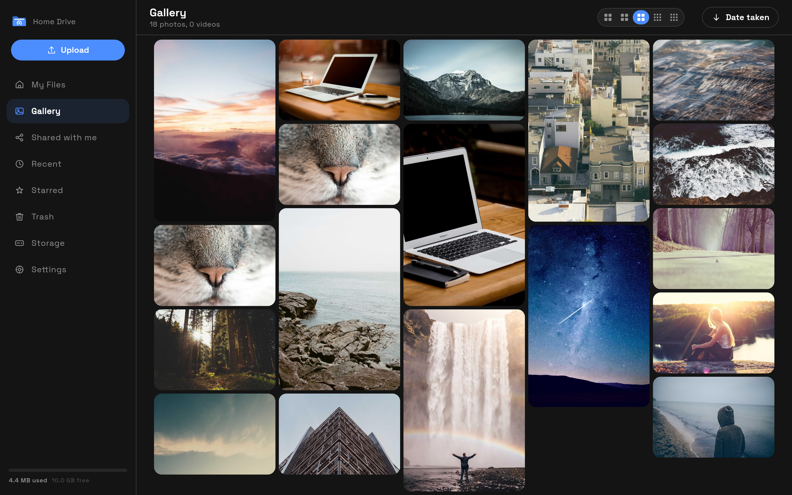
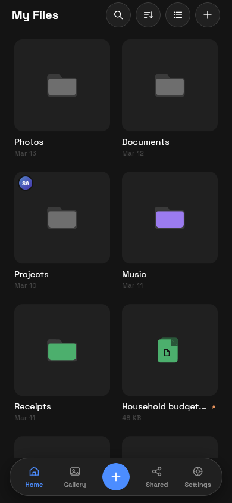

<div align="center">


#  KiDrive

**Your Private Cloud. Your Hardware. Your Data.**

An open-source, self-hosted cloud storage and Network Attached Storage (NAS) solution designed to give you control over your files, privacy, and infrastructure.

Build and manage your own personal cloud with a modern web interface, cross-platform applications, file sharing, media management, and flexible deployment options.

[](LICENSE)
[](server/go.mod)
[](localdrive/pubspec.yaml)
[](web-client/package.json)
[](#-supported-platforms)

[Quick Start](#-quick-start) |
[Key Features](#-key-features) |
[Supported Platforms](#-supported-platforms) |
[Project Structure](#-project-structure) |
[Installation Guides](Cai_Dat_Tat_Ca_OS/HUONG_DAN_CAI_DAT_TAT_CA_OS.txt) |
[License](#-license-and-attribution)

</div>

---

## 📖 Overview

**KiDrive (LocalDrive)** is a self-hosted personal cloud storage platform that allows individuals, families, developers, and organizations to store, access, organize, and manage their files on hardware they own or control.

Unlike traditional cloud storage services, KiDrive is designed to operate on your own infrastructure without requiring a third-party storage subscription.

The platform combines a Go-based backend, a Next.js web interface, and Flutter-based client applications into a unified storage ecosystem.

### Why KiDrive?

- **Self-Hosted Storage:** Keep your files on your own servers, computers, or NAS devices.
- **Privacy and Control:** Manage your own storage infrastructure and access permissions.
- **Open Source:** Inspect, modify, redistribute, and contribute to the source code under the MIT License.
- **Cross-Platform Architecture:** Support multiple operating systems through dedicated server and client components.
- **Modern File Management:** Organize files and folders through accessible desktop, mobile, and web interfaces.
- **Flexible Deployment:** Deploy on compatible physical servers, virtual machines, or container environments.
- **No Mandatory Subscription:** Use your own hardware without paying a mandatory software subscription.
- **Scalable Storage Capacity:** Expand your storage according to available hardware, filesystem, and deployment resources.

KiDrive is intended for personal cloud storage, home laboratories, private infrastructure, and self-hosted file management.

---

## 📸 Screenshots & Visual Preview

<div align="center">

### 💻 Desktop File Manager


<br><br>

### 🖼️ Media Gallery & Timeline


<br><br>

### 🪟 Windows File Explorer Integration (KiyoDrive)
*Seamlessly integrated as a dedicated Network Location under **This PC** in Windows Explorer:*
<br>


<br><br>

### 📱 Mobile Experience (Android / iOS)
<p align="center">
  &nbsp;&nbsp;&nbsp;&nbsp;&nbsp;&nbsp;&nbsp;&nbsp;
  
</p>

</div>

---

## ⚡ Quick Start

KiDrive provides several installation and deployment options depending on the target operating system.

> **Release availability:** As of October 23, 2026, the primary KiDrive repository does not have published GitHub Releases. The installation methods below may require building the software from source or providing compatible binaries. The automated installer cannot complete successfully unless its required server binary is available.

### 🐧 1. Linux Server

**Automated installation for compatible systemd-based Linux distributions.**

The installation script currently supports automatic CPU architecture detection for:

- AMD64 / x86_64
- ARM64 / AArch64

The installer is designed to configure the backend service, initialize storage directories, register a systemd service, and configure supported firewalls.

Typical target distributions include:

- Ubuntu
- Debian
- Fedora
- CentOS Stream
- AlmaLinux
- Rocky Linux
- Raspberry Pi OS (64-bit installations using systemd)
- Other compatible systemd-based Linux distributions

**Important:** Alpine Linux typically uses OpenRC rather than systemd and is not supported by the current automated systemd installation procedure without modifications.

#### Method 1: Download and Run the Installer (Recommended)

```bash
curl -fsSL https://raw.githubusercontent.com/kiyogo/kidrive/main/install.sh -o install.sh
```

Review the downloaded installation script before execution.

```bash
sudo bash install.sh
```

The installer requires a compatible local server binary or a downloadable binary from a configured GitHub Release.

#### Method 2: Direct Installation

For users who have reviewed and trust the installation script:

```bash
curl -fsSL https://raw.githubusercontent.com/kiyogo/kidrive/main/install.sh | sudo bash
```

This command downloads and executes the remote script with elevated privileges.

> **Security Notice:** Running scripts downloaded from the internet with root privileges introduces security risks. Reviewing the script before execution is strongly recommended.

#### Default Server Addresses

After a successful installation, the default configuration uses:

**Web Interface:**

```text
http://SERVER_IP:5437
```

**Backend API:**

```text
http://SERVER_IP:9683
```

Replace `SERVER_IP` with the actual IP address of your server.

If your local network has been configured to resolve the hostname `kinas`, you may also access:

```text
http://kinas:5437
```

Hostname resolution is dependent on your network configuration and is not guaranteed automatically.

#### Default Installation Paths

| Component | Default Location |
|-----------|------------------|
| Server executable | `/usr/local/bin/localdrive` |
| Installation directory | `/var/lib/localdrive` |
| File storage | `/var/lib/localdrive/data` |
| SQLite database | `/var/lib/localdrive/localdrive.db` |
| Environment configuration | `/var/lib/localdrive/.env` |
| Systemd service | `/etc/systemd/system/localdrive.service` |

The current installer configures the server to start automatically through systemd and restart when the service unexpectedly exits.

---

### 🪟 2. Windows

KiDrive includes a Windows-compatible architecture consisting of a Go backend and a Flutter desktop application.

#### Method 1: Windows Installer

When an official Windows installer is published, download it from:

**[GitHub Releases](https://github.com/kiyogo/kidrive/releases)**

The planned installer package is:

```text
LocalDrive-Setup.exe
```

The Windows installation workflow is designed to support:

- Desktop application installation
- Windows Start Menu shortcuts
- Optional automatic startup
- Background server operation
- File management integration
- Application uninstallation

**Note:** Installer availability and individual Windows shell integration features depend on the published build and its implementation.

#### Method 2: Run the Server From Source

Install the required Go toolchain and clone the repository:

```powershell
git clone https://github.com/kiyogo/kidrive.git
```

Navigate to the Go backend:

```powershell
cd kidrive\server
```

Run the server:

```powershell
go run ./cmd/localdrive serve
```

This starts the backend from source, subject to the requirements of the current codebase.

A source-based server launch does not automatically install a Windows service or a File Explorer integration.

---

### 🍎 3. macOS

KiDrive includes a cross-platform client architecture intended for macOS.

The available deployment documentation covers Intel-based and Apple Silicon Macs.

Supported target CPU architectures include:

- AMD64 for Intel Macs
- ARM64 for Apple Silicon Macs

For platform-specific installation and deployment instructions, see:

[macOS Installation Documentation](Cai_Dat_Tat_Ca_OS/3_macOS/)

Binary availability depends on the release artifacts or a successful source build.

---

### 🐳 4. Docker and Docker Compose

KiDrive includes a Docker Compose configuration for container-based deployment.

Navigate to the Docker deployment directory:

```bash
cd Cai_Dat_Tat_Ca_OS/5_Docker
```

The current Compose file references the image:

```text
localdrive:latest
```

Before starting the containers, ensure that a compatible image with this name is available locally or from a configured container registry.

The Compose file does not automatically build an image from source.

Once the required image is available, start the service:

```bash
docker compose up -d
```

Check the container status:

```bash
docker compose ps
```

View application logs:

```bash
docker compose logs -f
```

Stop the containers:

```bash
docker compose down
```

The Compose configuration exposes the following default ports:

| Service | Port | Protocol |
|---------|------|----------|
| Web Interface | 5437 | TCP |
| Backend API | 9683 | TCP |

Persistent storage is configured through bind mounts for application data and the database.

Docker deployment can be adapted for compatible container hosts, including Linux servers and NAS environments that support Docker.

---

## 🌟 Key Features

### 🛡️ 1. Self-Hosted Storage and Data Ownership

KiDrive is designed to give users direct control over their personal cloud infrastructure.

- Store files on hardware you own or manage.
- Avoid mandatory third-party storage subscriptions.
- Control where application data is stored.
- Configure user access and storage permissions.
- Expand capacity according to available disks and infrastructure.
- Operate within private local networks.
- Configure remote access when required.

Storage capacity is determined by the underlying filesystem, available disk space, hardware, and deployment configuration.

Remote access and public file sharing require appropriate network and security configuration.

### 🌐 2. Modern Web Interface

KiDrive includes a web interface developed using:

- Next.js 16
- React 19
- TypeScript
- Tailwind CSS

The interface is designed to provide a modern file management experience through a web browser.

Features and interface components include:

- File and folder browsing
- File uploads and downloads
- File and folder management
- Drag-and-drop interactions
- Image and media previews
- Responsive layouts
- Light and dark appearance options
- File information and details
- Sharing-related interfaces
- Account and application settings

**Default Web Port:** `5437`

### 💻 3. Desktop Applications and System Integration

KiDrive uses Flutter for its cross-platform client architecture.

The desktop experience is intended to provide convenient access to remote files and personal storage.

Relevant capabilities and integration targets include:

- Desktop file management
- File upload and download operations
- Background transfer handling
- Local metadata caching
- Desktop notifications
- System tray integration
- Startup integration
- Native file selection
- Drag-and-drop support

On Windows, the project also targets integration with File Explorer.

A dedicated drive displayed in **This PC** requires functioning Windows shell or filesystem integration and must be verified for the specific release.

### 📱 4. Cross-Platform Client Architecture

The client codebase is based on Flutter and targets multiple platforms.

- Windows
- macOS
- Linux
- Android
- iOS
- Web

Platform availability may vary depending on build configuration, native dependencies, supported devices, and published installation packages.

### 🔄 5. Resumable File Transfers

KiDrive incorporates a file transfer architecture that supports resumable upload workflows.

The backend includes dependencies for the tus resumable upload protocol.

The transfer architecture is designed for:

- Uploading large files
- Chunked transfer workflows
- Recovering interrupted uploads
- Tracking transfer progress
- Managing transfer queues
- Reducing unnecessary retransmission
- Improving reliability over unstable connections

Actual resume behavior depends on the upload implementation, transfer state, and server configuration.

### 📸 6. Photo and Video Gallery

KiDrive includes components for browsing and managing personal media libraries.

The gallery experience is designed around:

- Photo browsing
- Video playback
- Thumbnail previews
- Masonry-style image layouts
- Image zooming
- Media organization
- Responsive media grids
- Efficient image caching

Image quality and playback performance depend on the source media, device capabilities, browser or application support, and network conditions.

### 👥 7. User Accounts and Access Management

KiDrive is designed to support user account management for shared personal or organizational deployments.

Relevant functionality includes:

- User authentication
- Administrator accounts
- User management
- Access permissions
- File ownership
- Shared storage workflows
- Private file access
- Account management interfaces

Administrators remain responsible for configuring appropriate permissions and protecting the server from unauthorized access.

### 🌍 8. Localization and Internationalization

KiDrive is designed with multilingual support in mind.

The project's localization targets include:

- English
- Vietnamese
- Arabic

The availability and completeness of translated interface strings may vary by platform and application version.

### ⚙️ 9. Lightweight Go Backend

The server backend is implemented in Go.

Its architecture is designed to provide:

- Native compiled server binaries
- HTTP API services
- File and directory operations
- Authentication and authorization
- Storage management
- SQLite-based metadata persistence
- Background server execution
- Integration with client applications

A native Go server can reduce runtime deployment requirements compared with applications that require a separate language runtime.

Actual resource consumption and performance depend on workload, implementation, hardware, and configuration.

---

## 💻 Supported Platforms

KiDrive separates server deployment support from client application targets.

| Platform | Server Deployment | Client Application |
|----------|-------------------|-------------------|
| Windows | Go backend | Flutter desktop |
| Linux | Go backend, systemd deployment | Flutter desktop |
| macOS | Go backend build target | Flutter desktop |
| Android | Not a primary server deployment target | Flutter mobile |
| iOS | Not a primary server deployment target | Flutter mobile |
| Web Browser | Access through a hosted server | Next.js web interface |
| Docker | Container deployment | Browser-based access |

**Compatibility Notice:** The table describes the project's architecture and intended platform coverage. It does not guarantee that a tested binary or installer is currently published for every platform.

### CPU Architecture Support

The Linux installation script currently recognizes:

```text
x86_64 / amd64
aarch64 / arm64
```

Other CPU architectures require additional build and compatibility verification.

---

## 📁 Project Structure

The project follows a modular architecture that separates the backend, client applications, web interface, deployment resources, and documentation.

```text
kidrive/
│
├── Cai_Dat_Tat_Ca_OS/
│   │
│   ├── 1_Windows/
│   │   └── Windows installation resources
│   │
│   ├── 2_Linux/
│   │   └── Linux installation scripts and guides
│   │
│   ├── 3_macOS/
│   │   └── macOS deployment documentation
│   │
│   ├── 4_Android/
│   │   └── Android application installation guides
│   │
│   ├── 5_Docker/
│   │   └── Docker Compose deployment configuration
│   │
│   └── HUONG_DAN_CAI_DAT_TAT_CA_OS.txt
│
├── server/
│   │
│   ├── cmd/
│   │   └── localdrive/
│   │       └── Server and CLI entry point
│   │
│   ├── internal/
│   │   └── Core backend implementation
│   │
│   ├── migrations/
│   │   └── Database schema migrations
│   │
│   └── go.mod
│
├── localdrive/
│   │
│   ├── lib/
│   │   └── Flutter application source
│   │
│   ├── windows/
│   │   └── Native Windows integration
│   │
│   └── pubspec.yaml
│
├── web-client/
│   │
│   ├── src/
│   │   └── Next.js application source
│   │
│   ├── public/
│   │   └── Public assets
│   │
│   └── package.json
│
├── docs/
│   └── Technical documentation and assets
│
├── e2e/
│   └── End-to-end tests
│
├── scripts/
│   └── Development and automation scripts
│
├── .github/
│   └── GitHub workflows and repository configuration
│
├── install.sh
├── LICENSE
├── README.md
├── SECURITY.md
├── CONTRIBUTING.md
└── CODE_OF_CONDUCT.md
```

### Core Technology Stack

| Component | Technology |
|-----------|------------|
| Backend | Go 1.25 |
| Web Frontend | Next.js 16 |
| Web UI Library | React 19 |
| Web Language | TypeScript |
| Web Styling | Tailwind CSS |
| Desktop and Mobile | Flutter / Dart |
| Database | SQLite |
| API Transport | HTTP |
| Resumable Uploads | tus-based architecture |
| Container Deployment | Docker Compose |
| Linux Service Management | systemd |

---

## 🔧 Linux Service Management

When installed through the provided Linux installation script on a compatible systemd-based distribution, KiDrive is registered as a system service.

The default service name is:

```text
localdrive
```

### Check Service Status

```bash
sudo systemctl status localdrive
```

### Start the Service

```bash
sudo systemctl start localdrive
```

### Stop the Service

```bash
sudo systemctl stop localdrive
```

### Restart the Service

```bash
sudo systemctl restart localdrive
```

### Enable Automatic Startup

```bash
sudo systemctl enable localdrive
```

### Disable Automatic Startup

```bash
sudo systemctl disable localdrive
```

### View Real-Time Logs

```bash
sudo journalctl -u localdrive -f
```

### View Recent Logs

```bash
sudo journalctl -u localdrive -n 100 --no-pager
```

These commands apply only when the `localdrive` systemd service has been installed successfully.

---

## 🔐 Security and Privacy

KiDrive is designed for self-hosted storage, but secure deployment remains the responsibility of the server administrator.

Recommended practices include:

- Use strong account passwords.
- Restrict administrator access.
- Keep the host operating system updated.
- Keep application dependencies updated.
- Configure firewall rules carefully.
- Use HTTPS for access across untrusted networks.
- Avoid exposing administrative endpoints unnecessarily.
- Protect application secrets and database files.
- Maintain regular backups.
- Test backup restoration procedures.
- Review security updates before deployment.

### Network Security

The default configuration uses HTTP ports `5437` and `9683`.

For internet-facing deployments, HTTPS should be configured through a suitable TLS-enabled reverse proxy or another secure access mechanism.

Do not assume that the default HTTP configuration provides encrypted communication.

### Data Protection

Self-hosting gives administrators control over their own data infrastructure.

However, self-hosting alone does not guarantee complete security, unlimited reliability, or protection against hardware failures.

Important data should be backed up independently.

For security issues and responsible vulnerability disclosure, refer to [SECURITY.md](SECURITY.md).

---

## 🔗 Repositories and Project Links

### Primary Repository

**KiDrive by KiyoGo**

https://github.com/kiyogo/kidrive

The primary repository for the KiDrive project.

### Secondary Repository

**LocalDrive by ngdaison**

https://github.com/ngdaison/LocalDrive

An additional repository based on the original LocalDrive project.

### Original Upstream Project

**LocalDrive by MultiX0**

https://github.com/MultiX0/LocalDrive

The original open-source project on which this project is based.

### Downloads

**GitHub Releases**

https://github.com/kiyogo/kidrive/releases

Installation packages and compiled binaries will be available here when releases are published.

---

## 🤝 Contributing

Contributions are welcome.

Developers are encouraged to contribute through:

- Bug reports
- Feature proposals
- Documentation improvements
- Performance optimizations
- Security improvements
- Accessibility improvements
- Translation updates
- Platform compatibility enhancements
- Pull requests

Before contributing, please read:

[CONTRIBUTING.md](CONTRIBUTING.md)

All contributions should respect the project's coding standards, security requirements, and licensing obligations.

---

## ⚖️ License and Attribution

KiDrive is built upon the original open-source **LocalDrive** project created by **MultiX0**.

We sincerely acknowledge and appreciate MultiX0 and all contributors to the original LocalDrive project for their work in developing and maintaining its foundation.

KiDrive extends and adapts that foundation for its own development and deployment goals.

### License

This project is distributed under the **MIT License**.

Copyright (c) 2026 **MultiX0**

https://github.com/MultiX0/LocalDrive

Copyright (c) 2026 **KiyoGo / KiDrive**

https://github.com/kiyogo/kidrive

Subject to the terms of the MIT License, permission is granted to use, copy, modify, merge, publish, distribute, sublicense, and sell copies of the software.

Redistributions must retain the applicable copyright and permission notices.

The software is provided **"AS IS"**, without warranty of any kind, as described in the license.

For the complete license terms, see:

**[LICENSE](LICENSE)**

---

<div align="center">

**KiDrive: Your Cloud. Your Storage. Your Control.**

Open Source | Self-Hosted | Cross-Platform

Developed by [KiyoGo](https://github.com/kiyogo)  
Based on [LocalDrive by MultiX0](https://github.com/MultiX0/LocalDrive)

</div>
